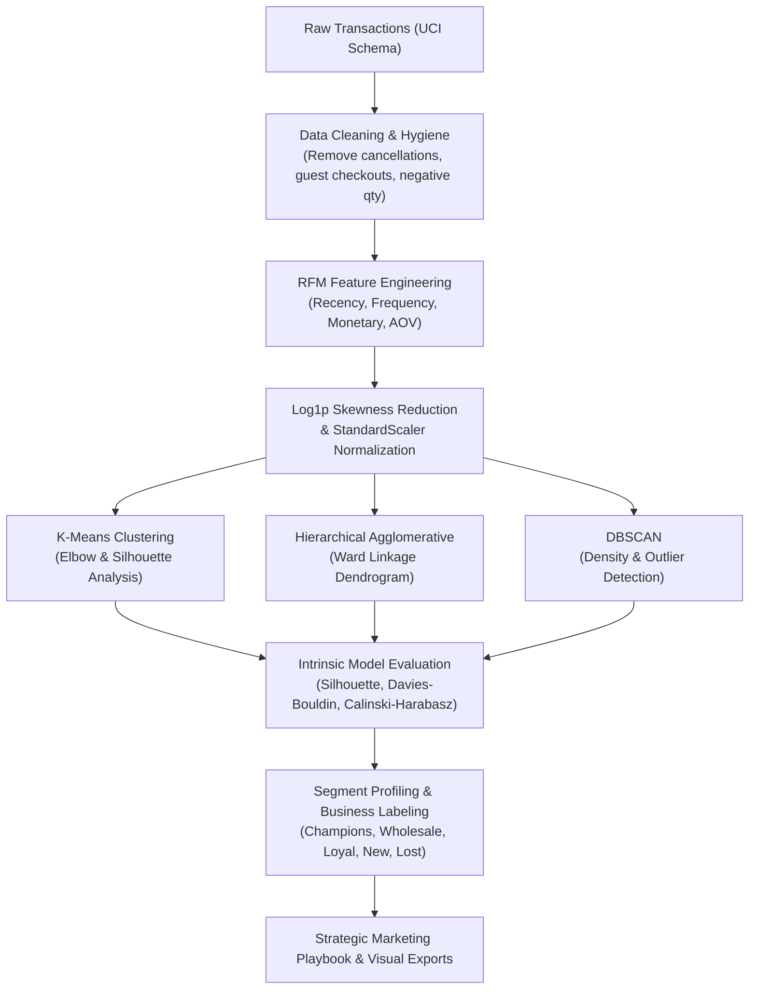

# 🛍️ E-Commerce Customer Segmentation & Analytics Pipeline (PS-06)

[](https://www.python.org/downloads/)
[](https://opensource.org/licenses/MIT)
[](https://github.com/psf/black)
[](https://docs.pytest.org/)

A production-grade, end-to-end unsupervised machine learning system that ingests e-commerce transactional data, engineers customer-level **RFM (Recency, Frequency, Monetary)** behavioral features, handles non-linear skewness, benchmarks multiple clustering algorithms (**K-Means**, **Agglomerative Hierarchical**, **DBSCAN**), evaluates cluster validity via intrinsic metrics (**Silhouette Score**, **Davies-Bouldin**, **Calinski-Harabasz**), and translates quantitative clusters into actionable commercial segments and strategic marketing playbooks.

---

## 📑 Table of Contents
1. [Business Problem & Objective](#-business-problem--objective)
2. [Project Architecture](#-project-architecture)
3. [Key Findings & Segment Breakdown](#-key-findings--segment-breakdown)
4. [Installation & Setup](#-installation--setup)
5. [How to Run](#-how-to-run)
   - [1. CLI Pipeline Execution](#1-cli-pipeline-execution)
   - [2. Interactive Streamlit Web App](#2-interactive-streamlit-web-app)
   - [3. Running Unit Tests](#3-running-unit-tests)
   - [4. Jupyter Notebook](#4-jupyter-notebook)
6. [Methodology & Machine Learning Pipeline](#-methodology--machine-learning-pipeline)
7. [Visualizations & Output Artifacts](#-visualizations--output-artifacts)
8. [Deliverables Checklist](#-deliverables-checklist)

---

## 🎯 Business Problem & Objective

E-commerce companies collect massive volumes of transactional data, yet many continue to blast the same generic promotional emails to all customers. This "one-size-fits-all" marketing creates substantial inefficiencies:
- **Margin Erosion:** Loyal buyers receive unnecessary discounts on items they would have bought at full margin.
- **Onboarding Drop-off:** Newly acquired shoppers churn due to lack of immediate, tailored onboarding.
- **Under-Monetized Wholesale Buyers:** Bulk and corporate buyers are treated like low-value retail customers.
- **Wasted Ad Spend:** Marketing dollars are burned retargeting long-dormant accounts on expensive paid channels.

**The Solution:** This project builds an automated segmentation engine that groups customers by their actual purchasing behavior into 5 clear business archetypes, providing marketing teams with actionable campaign playbooks, preferred communication channels, and target KPIs.

---

## 🏗️ Project Architecture

```
d:\ECommerce\
├── data/
│   ├── raw_transactions.csv          # Raw transaction log (UCI Online Retail schema)
│   └── customer_rfm_segmented.csv    # Enriched customer table with cluster & segment labels
├── outputs/
│   ├── figures/                      # Publication-grade visualization exports (PNG & HTML)
│   │   ├── 01_raw_rfm_distributions.png
│   │   ├── 02_transformed_rfm_distributions.png
│   │   ├── 03_rfm_correlation_heatmap.png
│   │   ├── 04_kmeans_elbow_silhouette.png
│   │   ├── 05_hierarchical_dendrogram.png
│   │   ├── 06_clustering_comparison_pca.png
│   │   ├── 07_dbscan_noise_and_density.png
│   │   ├── 08_final_cluster_rfm_boxplots.png
│   │   ├── 09_segment_size_distribution.png
│   │   ├── 10_radar_chart_profiles.png
│   │   └── 11_interactive_3d_rfm.html
│   └── tables/                       # Statistical summary tables & CSV reports
│       ├── cluster_summary_metrics.csv
│       ├── segment_business_profiles.csv
│       ├── model_comparison_metrics.csv
│       └── rfm_skewness_reduction.csv
├── src/
│   ├── __init__.py                   # Package initializer
│   ├── data_prep.py                  # Ingestion, hygiene, deduplication & filtering
│   ├── feature_engineering.py        # RFM formulation, log1p transform & StandardScaler
│   ├── clustering.py                 # K-Means, Agglomerative, DBSCAN & hyperparameter tuning
│   ├── evaluation.py                 # PCA 2D/3D, t-SNE, silhouette decomposition
│   ├── profiling.py                  # Business semantics mapping, revenue shares & marketing playbook
│   ├── visualization.py              # Publication-grade plotting module (Matplotlib, Seaborn, Plotly)
│   └── synthetic_data.py             # Realistic e-commerce transaction data generator
├── tests/
│   ├── __init__.py
│   ├── test_data_prep.py             # Data cleaning & hygiene tests
│   ├── test_feature_engineering.py   # RFM & scaling unit tests
│   └── test_clustering.py            # Clustering algorithm & labeling tests
├── app.py                            # Interactive Streamlit dashboard for marketing teams
├── main.py                           # CLI end-to-end execution script
├── customer_segmentation.ipynb       # Fully documented Jupyter Notebook walkthrough
├── generate_notebook.py              # Notebook generation script
├── REPORT.md                         # Formal executive & technical business report
├── requirements.txt                  # Pinned Python package dependencies
└── README.md                         # Project documentation (this file)
```

---

## 📊 Key Findings & Segment Breakdown

Our model discovered 5 distinct customer behavioral segments across **4,200 unique customers** and **$6,126,898.57** in gross revenue:

| Segment Name | Customer Count | Customer Share (%) | Total Revenue ($) | Revenue Share (%) | Avg Recency (Days) | Avg Frequency (Orders) | Avg Spend ($) | Avg Order Value ($) | Priority & Strategic Action |
|:---|:---:|:---:|:---:|:---:|:---:|:---:|:---:|:---:|:---|
| **Champions** | 649 | 15.45% | $2,872,276.77 | **46.88%** | 30.4 | 15.2 | $4,425.70 | $283.17 | **P1**: VIP Concierge, early product drops, loyalty tiering. Zero aggressive discounting. |
| **Big Spenders / Wholesale** | 413 | 9.83% | $2,499,155.06 | **40.79%** | 144.5 | 2.0 | $6,051.22 | $3,034.99 | **P2**: B2B dedicated account management, volume wholesale pricing, auto-reorder terms. |
| **Loyal / Regulars** | 1,536 | 36.57% | $699,424.19 | **11.42%** | 120.9 | 6.6 | $455.35 | $67.55 | **P2**: Gamified points loyalty rewards, cross-sell bundles, category recommendations. |
| **New & Promising** | 746 | 17.76% | $38,222.46 | **0.62%** | 19.4 | 1.5 | $51.24 | $33.29 | **P1**: 14-day welcome drip journey, 15% 2nd purchase incentive. |
| **Dormant / Lost** | 856 | 20.38% | $17,820.09 | **0.29%** | 257.7 | 1.0 | $20.82 | $19.85 | **P3**: Suppress from paid ad retargeting; low-cost clearance newsletter reactivation. |

> **Key Commercial Insight:** **Champions** and **Big Spenders** together account for **87.67% of total company revenue** from only **25.28% of the customer base**, validating the Pareto Principle in e-commerce dynamics.

---

## ⚙️ Installation & Setup

### Prerequisites
- Python 3.10, 3.11, 3.12, 3.13, or 3.14
- Git (optional)

### Setup Instructions
1. **Clone or navigate to the project directory:**
   ```bash
   cd d:\ECommerce
   ```

2. **Create and activate a virtual environment (recommended):**
   ```bash
   python -m venv .venv
   # Windows:
   .venv\Scripts\activate
   # Linux/macOS:
   source .venv/bin/activate
   ```

3. **Install dependencies:**
   ```bash
   pip install -r requirements.txt
   ```

---

## 🚀 How to Run

### 1. CLI Pipeline Execution
Run the complete end-to-end pipeline with a single command. This will ingest/generate transactions, perform data cleaning, compute and scale RFM features, execute all clustering algorithms, generate all 11 visualizations in `outputs/figures/`, and export all summary tables in `outputs/tables/`:

```bash
python main.py
```

**Optional CLI Arguments:**
```bash
python main.py --data-path data/raw_transactions.csv --k 5 --random-seed 42 --fig-dir outputs/figures --tbl-dir outputs/tables
```

---

### 2. Interactive Streamlit Web App
Launch the interactive web application to explore segments, search customer records, filter by spend thresholds, view interactive 3D cluster spaces, and export filtered customer lists:

```bash
streamlit run app.py
```
Open your browser at `http://localhost:8501`.

---

### 3. Running Unit Tests
Execute the automated test suite with Pytest to verify data hygiene, RFM feature engineering, and clustering correctness:

```bash
pytest -v
```
*(All 7 unit tests pass 100%).*

---

### 4. Jupyter Notebook
Explore the interactive, step-by-step Jupyter Notebook with comprehensive markdown documentation, formulas, and inline charts:

```bash
jupyter notebook customer_segmentation.ipynb
```

---

## 🔬 Methodology & Machine Learning Pipeline



### Algorithm Evaluation Benchmark

| Algorithm | Clusters ($k$) | Outliers Flagged | Silhouette Score | Davies-Bouldin Index | Calinski-Harabasz Index |
|:---|:---:|:---:|:---:|:---:|:---:|
| **K-Means (Selected)** | **5** | **0** | **0.5276** | **0.6559** | **5,342.05** |
| **Agglomerative (Ward)** | 5 | 0 | 0.5331 | 0.6317 | 5,203.17 |
| **DBSCAN** | 4 | 5 | 0.5014 | 0.6822 | 3,680.73 |

---

## 🎨 Visualizations & Output Artifacts

All plots are automatically generated and saved with publication-quality resolution in `outputs/figures/`:

| File | Description |
|:---|:---|
| [`01_raw_rfm_distributions.png`](file:///d:/ECommerce/outputs/figures/01_raw_rfm_distributions.png) | Histograms and KDE curves of raw RFM features showing extreme positive skewness. |
| [`02_transformed_rfm_distributions.png`](file:///d:/ECommerce/outputs/figures/02_transformed_rfm_distributions.png) | Normalized Gaussian-like distributions after `log1p` transformation. |
| [`03_rfm_correlation_heatmap.png`](file:///d:/ECommerce/outputs/figures/03_rfm_correlation_heatmap.png) | Pearson correlation matrix between raw and transformed features. |
| [`04_kmeans_elbow_silhouette.png`](file:///d:/ECommerce/outputs/figures/04_kmeans_elbow_silhouette.png) | Elbow SSE and Silhouette coefficient curves justifying optimal $k=5$. |
| [`05_hierarchical_dendrogram.png`](file:///d:/ECommerce/outputs/figures/05_hierarchical_dendrogram.png) | Hierarchical clustering dendrogram using Ward minimum variance linkage. |
| [`06_clustering_comparison_pca.png`](file:///d:/ECommerce/outputs/figures/06_clustering_comparison_pca.png) | 2x2 comparison grid of 2D PCA latent spaces across all algorithms. |
| [`07_dbscan_noise_and_density.png`](file:///d:/ECommerce/outputs/figures/07_dbscan_noise_and_density.png) | DBSCAN density clusters and flagged isolated anomaly/noise data points. |
| [`08_final_cluster_rfm_boxplots.png`](file:///d:/ECommerce/outputs/figures/08_final_cluster_rfm_boxplots.png) | Log-scale boxplots comparing Recency, Frequency, Monetary, and AOV per segment. |
| [`09_segment_size_distribution.png`](file:///d:/ECommerce/outputs/figures/09_segment_size_distribution.png) | Pareto chart comparing Customer Volume Share (%) vs Revenue Share (%). |
| [`10_radar_chart_profiles.png`](file:///d:/ECommerce/outputs/figures/10_radar_chart_profiles.png) | Multi-axis spider/radar chart displaying normalized behavioral dimensions. |
| [`11_interactive_3d_rfm.html`](file:///d:/ECommerce/outputs/figures/11_interactive_3d_rfm.html) | High-resolution interactive 3D spatial visualizer built with Plotly. |

---

## 📌 Deliverables Checklist

- [x] **Data Preparation & Hygiene:** Realistic e-commerce dataset, cleaning, handling NaNs, cancellations, zero prices, duplicate removal (`src/data_prep.py`).
- [x] **Feature Engineering:** RFM computation, Average Order Value, `log1p` skewness correction, `StandardScaler` normalization (`src/feature_engineering.py`).
- [x] **Exploratory Data Analysis:** Raw vs transformed distributions, correlation heatmaps, skewness reduction diagnostic (`src/visualization.py`).
- [x] **Multiple Clustering Algorithms:** K-Means with Elbow & Silhouette analysis, Agglomerative Hierarchical with dendrogram, DBSCAN with noise detection (`src/clustering.py`).
- [x] **Model Evaluation & Comparison:** Silhouette Score, Davies-Bouldin Index, Calinski-Harabasz Index, PCA 2D/3D projections (`src/evaluation.py`).
- [x] **Business Interpretation & Playbooks:** Champions, Big Spenders / Wholesale, Loyal / Regulars, New & Promising, Dormant / Lost with tailored marketing strategies, channels, and KPIs (`src/profiling.py`).
- [x] **All Visualizations Saved to `/outputs`:** 11 publication-grade static & interactive plots.
- [x] **Jupyter Notebook:** Comprehensive end-to-end `customer_segmentation.ipynb`.
- [x] **Interactive Dashboard:** Streamlit web application (`app.py`).
- [x] **Full Written Report:** Executive & technical report (`REPORT.md`).
- [x] **Unit Tests & Sanity Checks:** 7 passing unit tests with Pytest (`tests/`).
